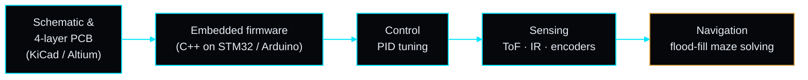

<!-- MADUKZ SPACE: animated lab hero (source: scripts/build_banner.py) -->

  

<h1 align="center">Maduka Malruk</h1>

<code>Electrical Engineering · University of Moratuwa · Sri Lanka</code>

<table align="center">
  <tr><td><b>Device</b></td><td>G. Maduka Malruk</td></tr>
  <tr><td><b>Role</b></td><td>BSc (Hons) Electrical Engineering, University of Moratuwa</td></tr>
  <tr><td><b>Focus</b></td><td>Autonomous micromouse robots · embedded control · PCB design</td></tr>
  <tr><td><b>Community</b></td><td>EESoc member · host of live whiteboard "kuppi" sessions for EE students</td></tr>
  <tr><td><b>Portfolio</b></td><td><a href="https://www.madukamalruk.com.lk/">madukamalruk.com.lk</a></td></tr>
</table>

 

## 01 · About

I design the robots, the boards that run them, and the firmware in between: schematic and 4-layer PCB, STM32 and Arduino firmware, PID wall-following, and flood-fill navigation. My current build is the micromouse for **Team MazeRiders**, which took **1st place at InnovMind v3.0 (June 2026)** and reached the **MazeMaster 2026 Top 5**.

Outside the lab I'm an active member of the **Electrical Engineering Society (EESoc)** and run kuppi streams, whiteboard peer-tutoring for university students. Hiking and camping across Sri Lanka (Knuckles, Raksagala, Hantane) and mobile and portrait photography keep me sane between boards.

## 02 · Stack

<table>
  <tr>
    <td><b>Languages</b></td>
    <td>
      
      
      
      
      
      
      
    </td>
  </tr>
  <tr>
    <td><b>Embedded</b></td>
    <td>
      
      
      
      
    </td>
  </tr>
  <tr>
    <td><b>PCB &amp; Electronics</b></td>
    <td>
      
      
      
      
      
      
    </td>
  </tr>
  <tr>
    <td><b>Simulation &amp; CAD</b></td>
    <td>
      
      
      
      
      
    </td>
  </tr>
  <tr>
    <td><b>Software &amp; Data</b></td>
    <td>
      
      
      
      
      
      
      
      
    </td>
  </tr>
  <tr>
    <td><b>Workflow</b></td>
    <td>
      
      
      
      
      
      
      
    </td>
  </tr>
</table>

 

<b>How a board becomes a robot</b>

 

## 03 · Build Log

Live cards are rebuilt every 3 hours from the GitHub API and served from the `output` branch.

<table>
<tr>
<td width="50%" valign="top">

<b>Micromouse V2.0</b> · Arduino Nano (ATmega328P) · 3× VL53L0X ToF · N20 encoders + TB6612FNG · PD wall-following · 16×16 flood-fill with the verified map stored in EEPROM · MazeMaster 2026 finalist
</td>
<td width="50%" valign="top">

<b>UoM Maze Solver 2025</b> · Arduino Uno · ultrasonic wall sensing + IR finish detection · no encoders · PID wall-following · flood-fill on a 9×9 maze · Team G16, UoM Electrical Engineering
</td>
</tr>
<tr>
<td width="50%" valign="top">

<b>Robo-Mouse v5 PCB</b> · 4-layer KiCad board (F / In1 / In2 / B.Cu) · STM32F405 · 25 MHz crystal · <i>archived, superseded by Neo-Mouse-PCB</i>
</td>
<td width="50%" valign="top">

<b>Neo-Mouse PCB</b> · Altium Designer · STM32F405RGT6 @ 168 MHz · ICM-42688-P IMU · DRV8833 driver · 4× VL53L0X + 4× IR emitter/receiver pairs · 2S LiPo → 5 V → 3.3 V LDO rails
</td>
</tr>
<tr>
<td width="50%" valign="top">

<b>Jac Personal Planner</b> · full-stack Jac · object-spatial graph of task, event and habit nodes · ByLLM agent walkers for scheduling and reflection · web + mobile front ends
</td>
<td width="50%" valign="top">

<b>UniPath LK</b> · Jac 0.16.7 object-spatial walkers over 37 verified programmes · ByLLM planner with a deterministic rules fallback · AI Hackathon 2026 submission
</td>
</tr>
</table>

**In progress:** polio patient walking aid (EE3204 Engineering Systems Design).

## 04 · Results

| When | Event | Outcome |
| :--- | :--- | :--- |
| Jun 2026 | InnovMind v3.0 Micromouse Competition | **1st place**, Team MazeRiders |
| 2026 | MazeMaster 2026 | **Top 5 finalist** |
| 2026 | SLIoT Challenge 2026 (University category) | Proposed and built a Raspberry Pi 4 IoT hidden-camera detector |
| — | SPARK Startup Challenge | Participant |
| Ongoing | Electrical Engineering Society (EESoc) | Active member |
| Ongoing | Kuppi live streams | Whiteboard peer-tutoring for UoM engineering students |

## 05 · Telemetry

  <picture>
    <source media="(prefers-color-scheme: dark)" srcset="https://raw.githubusercontent.com/madukamalruk/madukamalruk/output/github-contribution-grid-snake-dark.svg">
    <source media="(prefers-color-scheme: light)" srcset="https://raw.githubusercontent.com/madukamalruk/madukamalruk/output/github-contribution-grid-snake.svg">
    
  </picture>

 

  
  

 

  

## 06 · Contact

  
  
  
  
  

 

