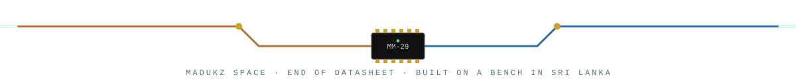

<!-- Visitor Badge -->

  

<!-- MADUKZ SPACE: animated lab banner (source: scripts/build_banner.py) -->

  

 

<!-- Animated Typing Header -->
<h1 align="center">
    
</h1>

<h3 align="center">Engineering the future with scalable architectures and embedded systems 🇱🇰</h3>

 

### ⚡ About Me

I turn engineering insights into scalable architectures, embedded systems, and robust robotics solutions. Currently pursuing my BSc (Hons) in Electrical Engineering at the **University of Moratuwa**.

- 🔭 **Current Focus:** Micromouse Project (Team MazeRiders) & MazeMaster 2026.
- ⚙️ **Interests:** Robotics, Embedded Systems, PCB Design, and Software Architecture.
- 🏆 **Community:** Active member of the Electrical Engineering Society (EESoc).
- 🌐 **Portfolio:** [www.madukamalruk.com.lk](https://www.madukamalruk.com.lk/)
- 📫 **Contact:** madukageeganage@gmail.com

 

<!-- Contact Badges -->

  
  
  
  
  

<h2 align="center">🛠️ My Skills & Experience</h2>

<h4 align="center">Languages</h4>

  &nbsp;&nbsp;&nbsp;
  &nbsp;&nbsp;&nbsp;
  &nbsp;&nbsp;&nbsp;
  &nbsp;&nbsp;&nbsp;
  &nbsp;&nbsp;&nbsp;
  

<h4 align="center">Frameworks & Libraries</h4>

  &nbsp;&nbsp;&nbsp;
  &nbsp;&nbsp;&nbsp;
  &nbsp;&nbsp;&nbsp;
  &nbsp;&nbsp;&nbsp;
  &nbsp;&nbsp;&nbsp;
  

<h4 align="center">Databases</h4>

  &nbsp;&nbsp;&nbsp;
  

<h4 align="center">Hardware & Embedded</h4>

  &nbsp;&nbsp;&nbsp;
  &nbsp;&nbsp;&nbsp;
  &nbsp;&nbsp;&nbsp;
  

<h4 align="center">Simulation & CAD Software</h4>

  &nbsp;&nbsp;&nbsp;
  &nbsp;&nbsp;&nbsp;
  &nbsp;&nbsp;&nbsp;
  

<h4 align="center">Tools</h4>

  &nbsp;&nbsp;&nbsp;
  &nbsp;&nbsp;&nbsp;
  &nbsp;&nbsp;&nbsp;
  

<h4 align="center">IDEs</h4>

  &nbsp;&nbsp;&nbsp;
  

<h4 align="center">Operating Systems</h4>

  &nbsp;&nbsp;&nbsp;
  &nbsp;&nbsp;&nbsp;
  

 

<h2 align="center">🔧 Featured Builds 🔧</h2>
 

  
  
  
  
  
  

 

<!-- Contribution Snake -->

  <h2>🐍 My Contributions 🐍</h2>
   
  <picture>
    <source media="(prefers-color-scheme: dark)" srcset="https://raw.githubusercontent.com/madukamalruk/madukamalruk/output/github-contribution-grid-snake-dark.svg">
    <source media="(prefers-color-scheme: light)" srcset="https://raw.githubusercontent.com/madukamalruk/madukamalruk/output/github-contribution-grid-snake.svg">
    
  </picture>
    

<h2 align="center">⚡ GitHub Stats ⚡</h2>
 

<!-- Activity Graph -->

  

 

<!-- Stats + languages: self-hosted, rebuilt every 3h (scripts/telemetry.py) -->

  
  

 

  

 

<!-- Footer -->

  
   
  ⚡ Designed &amp; wired by <a href="https://www.madukamalruk.com.lk/">Maduka Malruk</a> · stats refresh automatically every 3 hours

